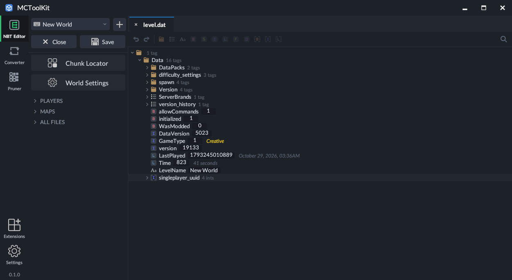
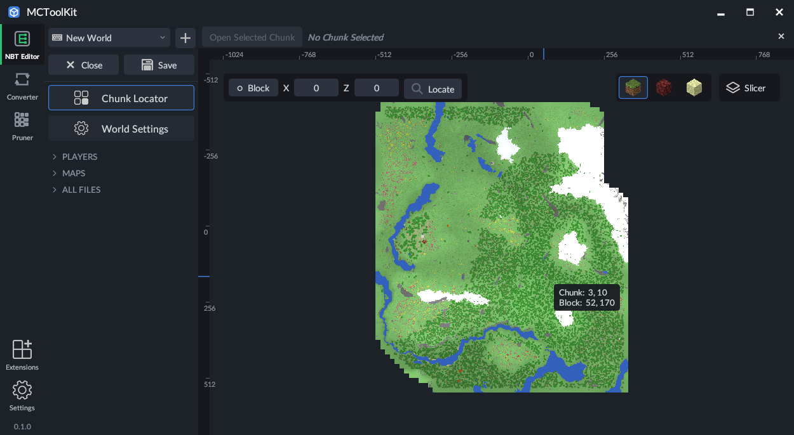
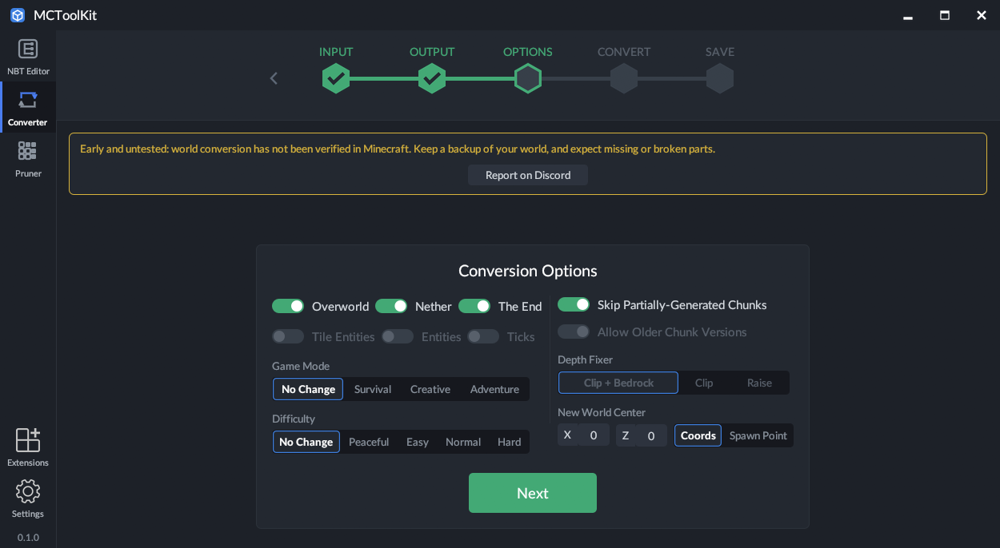
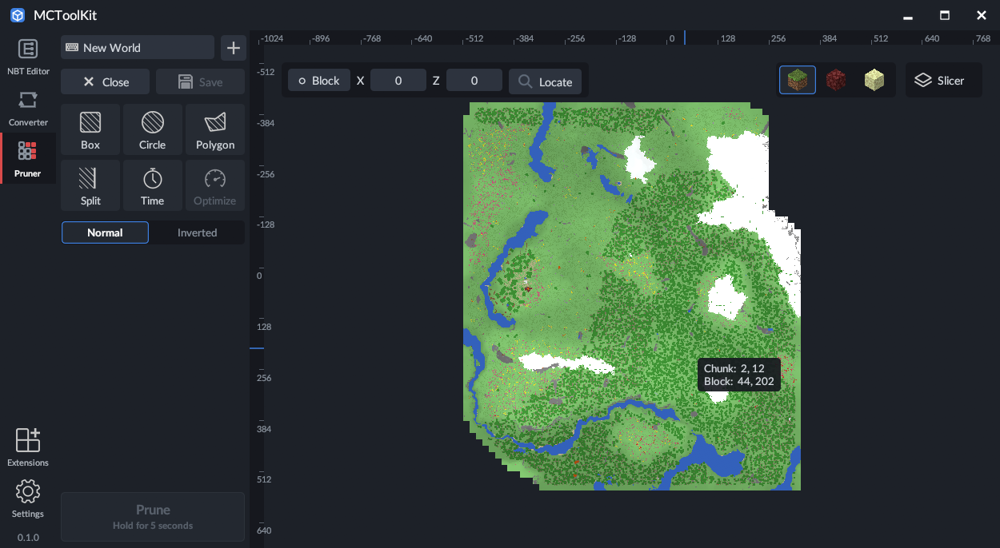

# MCToolKit

[](LICENSE)
[](https://github.com/TwoPlayz/MCToolKit/releases/latest)
[](https://www.rust-lang.org/tools/install)
[](https://github.com/TwoPlayz/MCToolKit/issues)
[](#contributing)
[](https://discord.gg/y5mECmtban)

A Minecraft world toolkit written in Rust: convert worlds between Java, Bedrock and Legacy
Console editions, prune chunks, edit NBT, browse a 2D map, and extend it with Lua scripts.

<p align="center">
  <a href="https://discord.gg/y5mECmtban"></a>
</p>

## Screenshots

| NBT Editor | Chunk Locator |
|:---:|:---:|
|  |  |
| **Converter** | **Pruner** |
|  |  |

> **Early and untested.** World conversion has been checked against sample worlds on disk, but
> converted worlds have **not** been opened in Minecraft yet. Keep a backup of your world and
> expect missing or broken parts. Found a problem? Join the community on Discord:
> <https://discord.gg/y5mECmtban>

## What it does

| Tool | What you can do |
|---|---|
| **Converter** | Java 1.13+ (best: 26.3) ↔ Bedrock 1.26.60, and Legacy Console (Xbox 360, PS3) → Java. Also reads older Java worlds (before 1.13, with numeric block ids) and older Bedrock worlds (from 1.2.13) when converting. |
| **Pruner** | Remove chunks (or keep only some) by Box, Circle, Split, Polygon or Time layers, working on a copy and writing back with a backup. |
| **NBT Editor** | Open worlds, players, maps and single NBT files; typed tree with undo; chunk locator. |
| **Extensions** | Lua 5.4 scripts that style the NBT editor or run as world tools. Import your own from a `.zip` or folder (see [`extensions/README.md`](extensions/README.md)). |

### What the converter carries over

Blocks (including waterlogging), biomes, height maps, `level.dat`, block entities (chests and
other containers, signs, spawners, banners, beds, skulls, lecterns, brewing stands and the rest),
mobs and paintings, item frames, and the local player. Items convert with enchantments, names,
lore, books, potions and container contents.

Not converted: entity details beyond type, position, motion, rotation, health, age, name and a
few mob-specific fields (villager trades, owners, equipment, variants), dropped items, and
falling blocks. Entities such as chest minecarts keep their entity but not their contents. The
report at the end of a conversion lists what was left out.

How it was checked, on sample worlds only:

- Java 26.3 → Bedrock: all 258 million blocks of the sample match their mapping; Bedrock → Java
  matches all 2.3 million blocks of a Bedrock 1.26.60 world; a round trip returns 99.94 %
  identical (the rest is flowing liquid).
- Legacy Console → Java → Bedrock: 89 million blocks across a PS3 and an Xbox 360 save match, and
  all 80 containers and 388 item stacks in them match.
- Pruner: each shape selection and its inverse keep exactly the expected chunks, byte for byte.
- Older Bedrock worlds (`{name, val}` blocks and numeric ids) are covered by unit tests only.

Console limits: a modified PS3 `GAMEDATA` needs `PARAM.PFD` re-signing and a modified Xbox 360
`savegame.dat` needs re-packing into its STFS container before a console accepts them. Wii U
saves are untested (no sample).

## Building from source

### 1. Prerequisites

- **Rust 1.85 or newer** (edition 2024), stable channel: install with
  [rustup](https://rustup.rs/), or run `rustup update` if you already have it.
- **A C compiler.** The Lua engine for extensions is compiled from bundled source.
  - Windows: [Visual Studio Build Tools](https://visualstudio.microsoft.com/visual-cpp-build-tools/)
    with the *Desktop development with C++* workload (this is also what rustup asks for).
  - Linux: `build-essential` (or your distribution's equivalent) plus the development packages for
    the windowing and file-dialog libraries, for example on Debian/Ubuntu:
    `sudo apt install build-essential pkg-config libgtk-3-dev libxkbcommon-dev libwayland-dev libx11-dev`
  - macOS: Xcode command line tools (`xcode-select --install`).
- **Git**, to clone the repository.

MCToolKit is developed and tested on Windows. Linux and macOS should build from the same
sources, but they have not been tried yet; reports and fixes are welcome.

### 2. Get the source and build

```
git clone https://github.com/TwoPlayz/MCToolKit.git
cd MCToolKit
cargo build --release
```

The first build downloads and compiles the dependencies and takes a few minutes; later builds
are quick. Build only what you need with `-p`:

```
cargo build --release -p mctk-gui   # the desktop app
cargo build --release -p mctk-cli   # the command-line tool
```

The programs are written to `target/release/`: `MCToolKit.exe` (the app) and `mctoolkit.exe`
(the command-line tool); on Linux and macOS there is no `.exe`. The app is a single file that
carries its own fonts, icons and built-in extensions, so you can copy it anywhere.

### 3. Run

```
cargo run --release -p mctk-gui             # the desktop app
cargo run --release -p mctk-cli -- --help   # the `mctoolkit` command-line tool
```

Use `--release`: world conversion and map rendering are many times slower in a debug build.

### 4. Test

```
cargo test --workspace
```

A few tests read sample worlds from `C:\Users\<you>\Desktop\Worlds`. They skip themselves when
that folder is missing, so the suite passes without any worlds installed.

### Maintainer notes

- **Update checks.** The app asks `https://api.github.com/repos/<owner>/<repo>/releases/latest`
  on startup. If you fork the project, change `REPO` in `crates/mctk-gui/src/update.rs`.
- **Third-party licences.** After changing dependencies, refresh
  `crates/mctk-gui/assets/rust-dependencies.tsv` and
  [`THIRD_PARTY_LICENSES.md`](THIRD_PARTY_LICENSES.md) (both list the crates from `Cargo.lock`
  with their licences).

## Contributing

Bug reports, conversion problems, new mappings, extensions and pull requests are all welcome.
Before opening a pull request, please make sure `cargo test --workspace` passes. For
questions or to share a world that converts badly, join the
[Discord](https://discord.gg/y5mECmtban). By contributing you agree that your work is released
under the project's licence (LGPL-3.0-or-later).

Command-line examples:

```
mctoolkit convert java-to-bedrock "New World" out-bedrock
mctoolkit convert bedrock-to-java "My World.mcworld" out-java
mctoolkit convert console-to-java savegame.dat out-java
mctoolkit prune java world pruned --circle 0,0,500 --time ">=1200"
mctoolkit world info "path/to/world"
mctoolkit nbt dump level.dat
mctoolkit ext install my-extension.zip
mctoolkit ext run my-extension --world "New World" --output out
```

Settings and imported extensions are stored under `%APPDATA%\MCToolKit` (`~/.config/MCToolKit`
elsewhere).

## Crates

| Crate | Purpose |
|---|---|
| `mctk-nbt` | NBT codec (big/little endian), compression detection, SNBT |
| `mctk-anvil` | Java Anvil region files |
| `mctk-java` | Java world model: `level.dat`, dimensions, chunks of every era, block states |
| `mctk-leveldb` | Pure-Rust LevelDB reader and writer (Mojang's zlib/deflate blocks) |
| `mctk-bedrock` | Bedrock worlds: folders and `.mcworld`, chunk keys, subchunks, biomes |
| `mctk-console` | Legacy Console saves: Xbox 360 and PS3 archives, chunk formats |
| `mctk-mapping` | Block, biome, item and entity tables, including the pre-1.13 id tables |
| `mctk-chunker` | A Rust port of parts of Chunker (block entities, items, entities, item frames, text) |
| `mctk-convert` | Edition conversion on a multi-threaded staged pipeline |
| `mctk-prune` | The pruner |
| `mctk-world` | Edition detection and chunk listing |
| `mctk-lua` | Sandboxed Lua extension host |
| `mctk-cli` | The `mctoolkit` command-line tool |
| `mctk-gui` | The desktop app |

Updates: the desktop app checks GitHub for a newer release when it starts and shows a notice in
the title bar (nothing is downloaded automatically). Turn it off in Settings → General → *Check
for Updates on Startup*.

## Credits and data sources

MCToolKit builds on public data and open-source work. The complete list of external code, data
and Rust dependencies with their licences is in
[`THIRD_PARTY_LICENSES.md`](THIRD_PARTY_LICENSES.md), and in the app under
**Settings → About & Licenses**. Per-source details:

- [`crates/mctk-mapping/data/NOTICE.md`](crates/mctk-mapping/data/NOTICE.md): block, item and
  entity tables (GeyserMC, misode/mcmeta, Mojang bedrock-samples facts, PrismarineJS
  minecraft-data, pmmp/BedrockData).
- [`crates/mctk-chunker/LICENSE-CHUNKER`](crates/mctk-chunker/LICENSE-CHUNKER): Chunker by Hive
  Games (MIT), ported to Rust in `mctk-chunker`.
- [`crates/mctk-gui/assets/extensions/NOTICE.md`](crates/mctk-gui/assets/extensions/NOTICE.md)
  and [`assets/icons/NOTICE.md`](crates/mctk-gui/assets/icons/NOTICE.md): the built-in
  extensions and icons.

Minecraft is a trademark of Mojang Synergies AB. MCToolKit is not affiliated with Mojang or
Microsoft.

## Licence

MCToolKit is free software under the **GNU Lesser General Public License, version 3 or (at your
option) any later version** (`LGPL-3.0-or-later`). The licence text is in [`LICENSE`](LICENSE)
(identical to [`COPYING.LESSER`](COPYING.LESSER)), together with [`COPYING`](COPYING), the GNU
GPL v3 that the LGPL builds on. In short: you can use, modify and share it; if you distribute a
modified version of the MCToolKit code, its source must be available under the same licence.

Third-party code and data keep their own licences, all compatible with the LGPL (MIT, BSD, Apache
2.0, Zlib, CC0, SIL OFL, CC BY 4.0), listed in [`THIRD_PARTY_LICENSES.md`](THIRD_PARTY_LICENSES.md).
`mctk-chunker` stays under its MIT licence because it is a port of Chunker.
