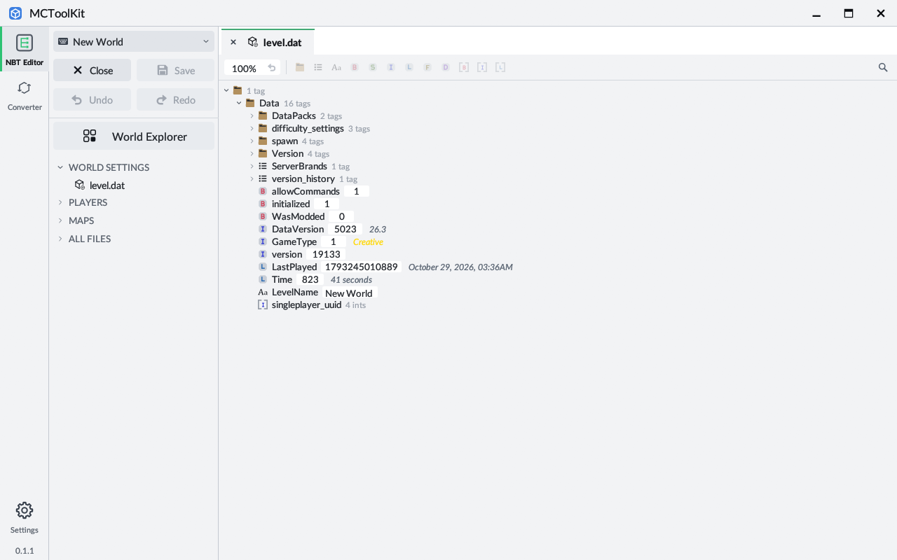
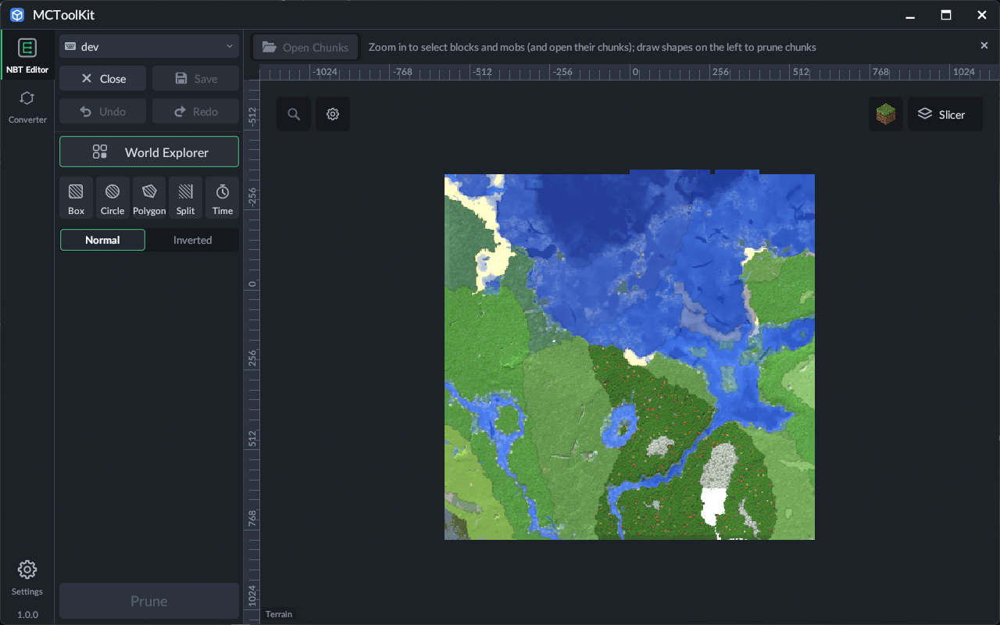
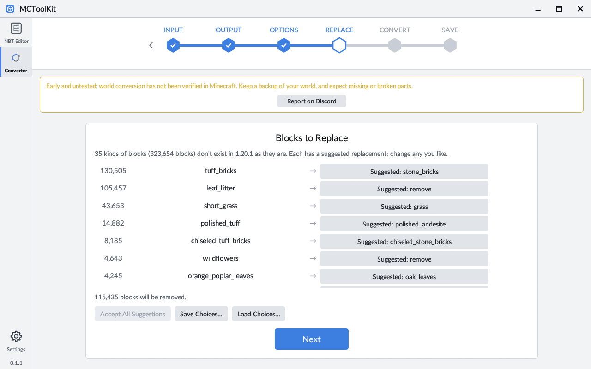
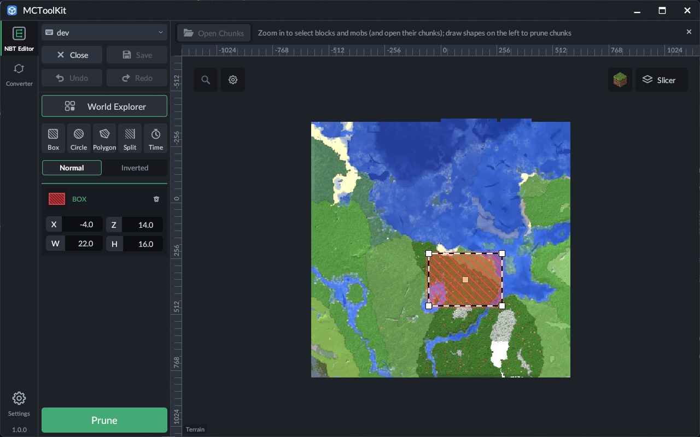
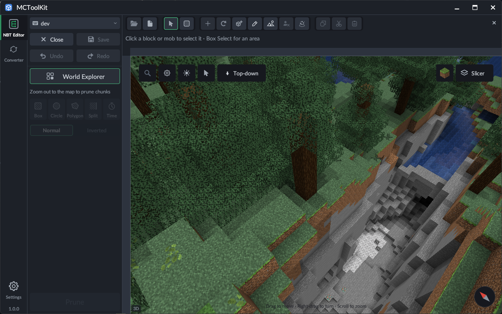

# MCToolKit

[](LICENSE)
[](https://github.com/TwoPlayz/MCToolKit/releases/latest)
[](https://www.rust-lang.org/tools/install)
[](https://github.com/TwoPlayz/MCToolKit/issues)
[](CONTRIBUTING.md)
[](https://discord.gg/wC6zC93fTS)

A Minecraft world toolkit written in Rust: convert worlds between Java, Bedrock and Legacy
Console editions, prune chunks, edit NBT, and explore and edit a world in 3D.

<p align="center">
  <a href="https://discord.gg/wC6zC93fTS"></a>
</p>

## Screenshots

| NBT Editor | Chunk Locator |
|:---:|:---:|
|  |  |
| **Converter** | **Pruner** |
|  |  |
| **World Explorer** | |
|  | |

> **Early and untested.** World conversion has been checked against sample worlds on disk, but
> converted worlds have **not** been opened in Minecraft yet. Keep a backup of your world and
> expect missing or broken parts. Found a problem? Join the community on Discord:
> <https://discord.gg/wC6zC93fTS>

## What it does

| Tool | What you can do |
|---|---|
| **Converter** | Java 1.8 – 26.3 (every release, as source and target) ↔ Bedrock 1.26.60, and Legacy Console (Xbox 360, PS3) ↔ Java, with a replace step for blocks the target cannot hold. Also reads older Java worlds (before 1.13, with numeric block ids) and older Bedrock worlds (from 1.2.13) when converting. |
| **Pruner** | Remove chunks (or keep only some) by Box, Circle, Split, Polygon or Time layers, working on a copy and writing back with a backup. |
| **NBT Editor** | Open worlds, players, maps and single NBT files; typed tree with undo; chunk locator. |
| **World Explorer** | A 3D view of a world (Java, Bedrock and Console) with real blocks, lighting, mobs, particles and a time of day, and the tools to change it, below. |

### World Explorer

Fly or orbit through the world and edit what you see; every change can be undone (Ctrl+Z, or
right-click Undo for the list of steps) and is written back, with a backup, when you save.

- **Select and edit.** Click a block, a mob or a box of blocks. The right-click menu moves it,
  turns it (or drag the turn handle), sets block states (a stair's shape, a door's hinge...),
  changes it to another block or mob, and deletes it.
- **Brush, fill, replace, copy and paste.** Spheres, cubes and whole chunks, with a mixed palette
  of blocks; paint anywhere, only where there is something, or only on the terrain below; paste
  and move boxes with a hologram, turn and mirror them.
- **Place.** One tool for a block, an armor stand, an item frame, a minecart or boat, or a mob.
- **Mobs and riders.** Add a rider (a new mob or one in the world), unmount it, or delete it; a
  mount seats one rider (two in a boat or on a camel). Riders can be selected like any mob.
- **Armor stands and item frames.** Put an item on each slot of a stand, pose it, make it small
  or armed; set, turn and take out the item of a frame, make it invisible or fixed.
- **Mob menus.** The same menu in the 3D view and in the NBT tree: edit a mob's gear and
  inventory slots, a villager's occupation and trades, and set whole-mob defaults.
- **Containers and beacons.** Lock chests, shulker boxes and dispensers; a **Beacon** submenu sets
  the primary and secondary power (any effect, not only the game's list), activates or disables
  the beacon, and shows its details in the 3D view.
- **Biomes.** The **Biome** tool paints the game's own 4 x 4 x 4 block cells: pick a biome from a
  searchable list, size the box along X, Y and Z (or take the full height), and click, or Alt+drag
  to paint along. The box is drawn in the biome's colour, the biome under the pointer is shown,
  the flat map's Biomes view and the sky follow it (a Nether or End biome gives that sky). Works
  on Java (every era), Bedrock and Console worlds.
- **Potion clouds and effects.** Place and edit lingering clouds (effects, strength, time or
  for ever, radius, colour, particles); mobs with effects show their particles.
- **Find.** Search a world for blocks and mobs by name and fly to them.
- **View.** Day or night, full bright, render distance, slicer, the free camera, a map overview.

Changes made in the explorer are shown in the NBT tree and chunk tabs without saving first
(marked edited, added or deleted), and share one undo history with the tree.

Editing Java worlds is the most complete; Bedrock and Console editions support the block,
mob move/turn/change, box and biome tools, but riders, clouds, armor stands and item frames
are Java only for now.

### What the converter carries over

Blocks (including waterlogging), biomes, height maps, `level.dat`, block entities (chests and
other containers, signs, spawners, banners, beds, skulls, lecterns, brewing stands and the rest),
mobs and paintings, item frames, and the local player. Items convert with enchantments, names,
lore, books, potions and container contents.

Items on the ground, falling blocks, and what chest and hopper minecarts and chest boats hold are
carried between Java, Bedrock and (to and from Java) the console editions. Item details that
both games have go across: enchantments, names and lore, armor trims, the blocks an item can be
placed on or break, fireworks and firework stars, a loaded crossbow's arrow, books, potions,
colors and container contents.

Not converted: entity details beyond type, position, motion, rotation, health, age, name and a
few mob-specific fields (villager trades, owners, equipment, variants), and item details with no
equivalent in the other game (Bedrock's item lock and keep-on-death, Java's attribute
modifiers on Bedrock items). The report at the end of a conversion lists what was left out.

How it was checked, on sample worlds only:

- Java 26.3 → Bedrock: all 258 million blocks of the sample match their mapping; Bedrock → Java
  matches all 2.3 million blocks of a Bedrock 1.26.60 world; a round trip returns 99.94 %
  identical (the rest is flowing liquid).
- Legacy Console → Java → Bedrock: 89 million blocks across a PS3 and an Xbox 360 save match, and
  all 80 containers and 388 item stacks in them match.
- Pruner: each shape selection and its inverse keep exactly the expected chunks, byte for byte.
- Older Bedrock worlds (`{name, val}` blocks and numeric ids) are covered by unit tests only.

Console limits: the converter can write a PS3 save folder signed for an account (region,
Account ID, PSID, User ID) or unencrypted, but none of it has been tried on a real console; a
modified Xbox 360 `savegame.dat` needs re-packing into its STFS container before a console
accepts it. Wii U saves are untested (no sample). Java to console conversion runs on all cores.

## Building from source

### 1. Prerequisites

- **Rust 1.85 or newer** (edition 2024), stable channel: install with
  [rustup](https://rustup.rs/), or run `rustup update` if you already have it.
  - Windows: [Visual Studio Build Tools](https://visualstudio.microsoft.com/visual-cpp-build-tools/)
    with the *Desktop development with C++* workload (this is also what rustup asks for).
  - Linux: `build-essential` (or your distribution's equivalent) plus the development packages for
    the windowing and file-dialog libraries, for example on Debian/Ubuntu:
    `sudo apt install build-essential pkg-config libgtk-3-dev libxkbcommon-dev libwayland-dev libx11-dev`
  - macOS: Xcode command line tools (`xcode-select --install`).
- **Git**, to clone the repository.

MCToolKit is developed and tested on Windows. Linux and macOS should build from the same
sources, but they have not been tried yet; reports and fixes are welcome.

### 2. Get the source and build

```
git clone https://github.com/TwoPlayz/MCToolKit.git
cd MCToolKit
cargo build --release
```

The first build downloads and compiles the dependencies and takes a few minutes; later builds
are quick. Build only what you need with `-p`:

```
cargo build --release -p mctk-gui   # the desktop app
cargo build --release -p mctk-cli   # the command-line tool

Release builds use thin link-time optimisation, so the first one takes a few minutes longer.
```

The programs are written to `target/release/`: `MCToolKit.exe` (the app) and `mctk.exe`
(the command-line tool); on Linux and macOS there is no `.exe`. The app is a single file that
carries its own fonts and icons, so you can copy it anywhere.

### 3. Run

```
cargo run --release -p mctk-gui             # the desktop app
cargo run --release -p mctk-cli -- --help   # the `mctk` command-line tool
```

Use `--release`: world conversion and map rendering are many times slower in a debug build.

## Command line

The `mctk` tool covers the same conversions, pruning and NBT tasks without the window. Examples:

```
mctk convert java-to-bedrock "New World" out-bedrock
mctk convert bedrock-to-java "My World.mcworld" out-java
mctk convert console-to-java savegame.dat out-java
mctk prune java world pruned --circle 0,0,500 --time ">=1200"
mctk world info "path/to/world"
mctk nbt dump level.dat
```

Settings are stored under `%APPDATA%\MCToolKit` (`~/.config/MCToolKit`
elsewhere). Working copies and unsaved conversion results are removed after a week, and stale
`mctk-...` folders in the system temp folder a day after a run that did not finish.

## Crates

| Crate | Purpose |
|---|---|
| `mctk-nbt` | NBT codec (big/little endian), compression detection, SNBT |
| `mctk-anvil` | Java Anvil region files |
| `mctk-java` | Java world model: `level.dat`, dimensions, chunks of every era, block states |
| `mctk-leveldb` | Pure-Rust LevelDB reader and writer (Mojang's zlib/deflate blocks) |
| `mctk-bedrock` | Bedrock worlds: folders and `.mcworld`, chunk keys, subchunks, biomes |
| `mctk-console` | Legacy Console saves: Xbox 360 and PS3 archives, chunk formats |
| `mctk-mapping` | Block, biome, item and entity tables, including the pre-1.13 id tables |
| `mctk-convert` | Edition conversion on a multi-threaded staged pipeline |
| `mctk-prune` | The pruner |
| `mctk-registry` | The block and state registries of every Java and Bedrock version |
| `mctk-replace` | Finding and replacing blocks across editions (the converter's replace step) |
| `mctk-gen` | Developer tool that generates the data tables in `mctk-mapping` from the games' own files |
| `mctk-world` | Edition detection and chunk listing |
| `mctk-cli` | The `mctk` command-line tool |
| `mctk-gui` | The desktop app |

Updates: a start-up screen checks GitHub for a newer release and the game assets for the newest
Minecraft. On Windows a newer release is downloaded, put in place of the running program and
started (the old file is removed on the next start); elsewhere, or if the program's folder is
not writable, a message says where to download it. Turn it off in Settings →
General → *Check for Updates on Startup*.

## Credits and data sources

MCToolKit builds on public data and open-source work. The complete list of external code, data
and Rust dependencies with their licences is in
[`THIRD_PARTY_LICENSES.md`](THIRD_PARTY_LICENSES.md), and in the app under
**Settings → About & Licenses**. Per-source details:

- [`crates/mctk-mapping/data/NOTICE.md`](crates/mctk-mapping/data/NOTICE.md): block, item and
  tables generated from the games themselves (see the notice).

Minecraft is a trademark of Mojang Synergies AB. MCToolKit is not affiliated with Mojang or
Microsoft.

## Licence

MCToolKit is free software under the **GNU Lesser General Public License, version 3 or (at your
option) any later version** (`LGPL-3.0-or-later`); the full text is in [`LICENSE`](LICENSE). In
short: you can use, modify and share it; if you distribute a modified version of the MCToolKit
code, its source must be available under the same licence.

Third-party code and data keep their own licences, all compatible with the LGPL, listed in
[`THIRD_PARTY_LICENSES.md`](THIRD_PARTY_LICENSES.md).

Want to help? See [`CONTRIBUTING.md`](CONTRIBUTING.md).